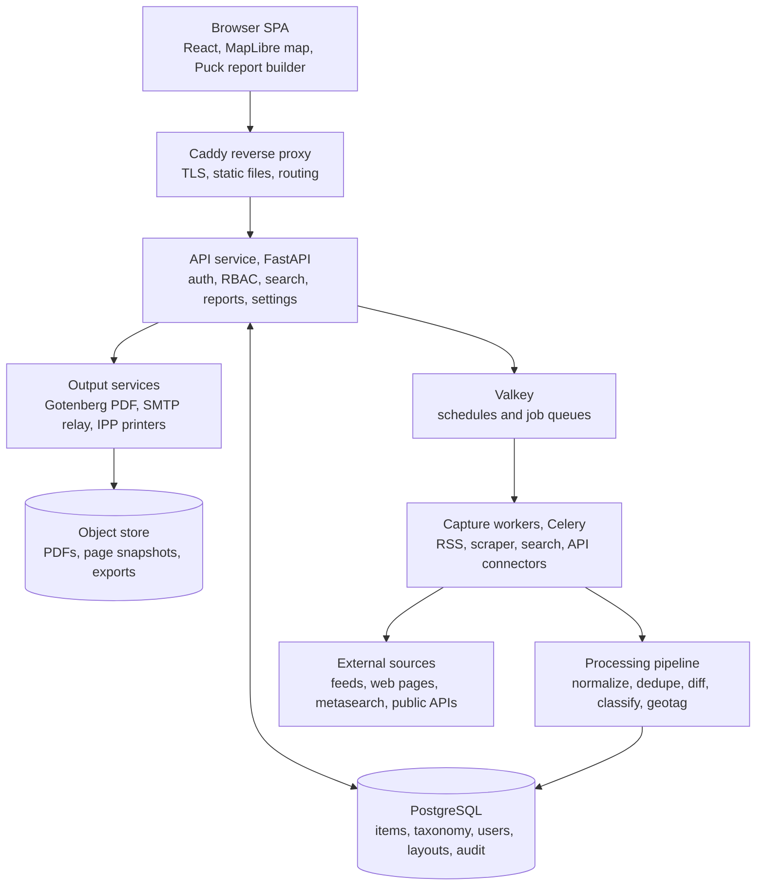

# 3. Architecture and technology stack

Decision: a modular monolith API (Python, FastAPI) with a separate worker pool for capture and processing, PostgreSQL as the only system of record, a React single-page application with a MapLibre choropleth, and sidecar containers for PDF rendering and optional search. Every component is permissively licensed or runs as an unmodified service behind a network boundary. Rationale and alternatives are recorded in ADR-0001 to ADR-0006 (section 3.7).

## 3.1 Component view

Reading: the browser talks only to the API through the proxy. Workers do all outbound fetching, so the API never reaches the internet; this is the SSRF boundary enforced in section 8. The processing pipeline is the only writer of captured items.

## 3.2 Stack decisions

| Layer | Choice | License | Why this and not the alternative |
| --- | --- | --- | --- |
| API | Python 3.12, FastAPI, Pydantic v2, SQLAlchemy 2, Alembic | MIT (all) | Same language as the scraping ecosystem (Scrapy, trafilatura, feedparser); auto-generated OpenAPI drives contract tests. Alternative Node/NestJS rejected to avoid two backend languages. |
| Workers and scheduling | Celery with Celery Beat, broker Valkey | BSD-3 (Celery), BSD-3 (Valkey) | Mature retry, rate-limit and periodic-task features. Valkey replaces Redis because Redis moved to RSAL/SSPL/AGPL licensing in 2024, which fails the license policy for bundled components. Alternative Procrastinate (PostgreSQL queue, MIT) noted for smaller deployments. |
| Database | PostgreSQL 16 with JSONB, full-text search, pg_trgm, optional pgvector | PostgreSQL License | One store for relational data, dynamic attributes (JSONB) and search avoids an extra search cluster for 50 users. Meilisearch (MIT) is the scale-out path if search latency exceeds 300 ms at p95. Elasticsearch rejected (SSPL/ELv2/AGPL). |
| Frontend | React 18, TypeScript, Vite, TanStack Query/Table/Router, Tailwind CSS, shadcn/ui on Radix primitives | MIT (all) | Largest ecosystem of accessible primitives; shadcn/ui components are copied into the repo so they can be themed for light, dark and high-contrast. |
| Map | MapLibre GL JS rendering a Natural Earth GeoJSON fill layer; optional self-hosted vector basemap via PMTiles | BSD-3 (MapLibre), public domain (Natural Earth), BSD-3 (PMTiles) | No tile subscription needed for a choropleth; vector rendering keeps country boundaries crisp in dark mode. Leaflet (BSD-2) is the fallback if WebGL is unavailable. |
| Charts | Apache ECharts | Apache-2.0 | Accessible labels, built-in dark theme, timeline and bar charts for reports. |
| Report builder | Puck visual editor with custom field components; dnd-kit for list ordering | MIT (both) | Puck already provides drag-and-drop page composition, saved JSON layouts and a plugin API, which covers REQ-12 and REQ-13. react-grid-layout (MIT) is the fallback if Puck's layout model proves too page-centric. |
| PDF rendering | Gotenberg container (Chromium and LibreOffice behind an HTTP API) | MIT | Renders the same HTML the browser prints, so screen and PDF match. WeasyPrint (BSD) is the fallback without a browser engine. |
| Email | aiosmtplib plus Python stdlib email; Mailpit in development | MIT (both) | Any SMTP relay; no vendor SDK. |
| Printing | Browser print dialog always; server-side IPP printing behind a feature flag, deferred from the first release (R-04, BL-13, BL-15) | n/a | pycups is GPL-2 and excluded; no Node IPP client passed the license gate. Python clients (ippx, aioipp; MIT) printed to a test server, but need a contract change (BL-15). |
| Authentication | Local accounts with Argon2id hashing (argon2-cffi), server-side sessions, optional OpenID Connect via Authlib in Phase 5; Keycloak as the reference identity provider for testing | MIT, BSD-3, Apache-2.0 | Keeps Phase 1 small; SSO added without changing the permission model. |
| Authorization | Role and permission tables in PostgreSQL enforced by a FastAPI dependency; Casbin considered if policies grow beyond role-to-permission | Apache-2.0 (pycasbin) | Explicit tables are auditable and simple for the admin UI in M1. |
| Content extraction | trafilatura 1.8 or later, readability-lxml fallback, Scrapy for crawl rules, Playwright for JavaScript-rendered pages | Apache-2.0, Apache-2.0, BSD-3, Apache-2.0 | trafilatura versions before 1.8.0 were GPLv3 and must not be pinned. |
| Feed parsing | feedparser | BSD-2 | De facto standard; handles malformed feeds. |
| Change detection | Own implementation using the approach of changedetection.io (Apache-2.0): fetch, extract, normalize, hash, diff with difflib | Apache-2.0 | Borrow patterns and optionally vendored helpers with attribution; do not run the whole app, since its UI duplicates ours. |
| Internet search | Provider interface with two implementations: self-hosted SearXNG instance (separate container, unmodified) and a commercial search API configured by key | AGPL-3.0 (service boundary only), n/a | SearXNG is used over HTTP and never modified or vendored; see license policy 3.5. |
| Optional classification | Rules engine first (keyword and taxonomy matching); optional language-model classifier behind one interface supporting a local model server or a hosted API, feature-flagged | MIT (Ollama) | No captured text leaves the deployment unless an admin enables a hosted provider (G6). |
| Reverse proxy and TLS | Caddy | Apache-2.0 | Automatic certificates, simple config. |
| Observability | structlog, OpenTelemetry SDK, Prometheus metrics endpoint; Grafana optional as tooling | MIT, Apache-2.0, Apache-2.0, AGPL (tooling only) | Grafana is never bundled with the product image. |
| Packaging | Docker Compose with health checks; multi-stage images; Kubernetes manifests deferred | Apache-2.0 (Compose spec) | Matches default G1. |

## 3.3 Runtime topology (default deployment)

Containers: `proxy` (Caddy), `api`, `worker` (scaled 1 to N), `beat` (scheduler, exactly one), `db` (PostgreSQL), `queue` (Valkey), `pdf` (Gotenberg), `search` (SearXNG, optional), `print-bridge` (optional), `mailpit` (development only). Persistent volumes: `pgdata`, `objectstore`. All inter-container traffic on an internal network; only `proxy` publishes ports 80 and 443.

## 3.4 Cross-cutting conventions

- **API style:** REST with JSON, versioned under `/api/v1`, OpenAPI 3.1 generated by FastAPI and committed as `openapi/regwatch.v1.json`; breaking changes require a new version path and an ADR.
- **Identifiers:** UUIDv7 primary keys everywhere (time-ordered, safe to expose).
- **Time:** stored in UTC, rendered in the user's time zone preference.
- **Dynamic attributes:** each captured item carries a validated JSONB `attributes` object whose schema is defined by taxonomy facets in M2, indexed with GIN.
- **Events:** internal domain events (`item.captured`, `item.changed`, `report.rendered`, `output.sent`) published on the queue; consumers include the map cache invalidator and the notification digest.
- **Configuration:** twelve-factor environment variables validated at startup by a Pydantic settings model; runtime-editable settings live in the `settings` table and are cached with invalidation on write.
- **Feature flags:** a `feature_flags` table read by API and workers; every optional integration (hosted model, server printing, SSO, metasearch) is behind a flag.
- **Error handling:** RFC 9457 problem-details responses; worker failures recorded in `capture_runs` with the exception class and a truncated message, never raw page content.

## 3.5 License policy (summary; full text in section 8.6)

Allowed for bundled code and assets: MIT, BSD-2, BSD-3, ISC, Apache-2.0, PostgreSQL, Zlib, Unlicense, CC0, public domain, MPL-2.0 (file-level; modified MPL files must be published), CC-BY-4.0 for data with attribution. Review required (ADR per use): LGPL-2.1/3.0 (dynamic linking only), EPL-2.0. Prohibited in bundled code: GPL-2.0/3.0, AGPL-3.0, SSPL, BUSL/BSL, Elastic License, RSAL, Commons Clause, Sustainable Use License, CC-BY-NC, CC-BY-SA for code. Permitted as unmodified separate services or developer tooling, never vendored: AGPL and GPL applications (SearXNG, Grafana, k6, Semgrep CLI). Every exception needs an ADR approved by the owner.

## 3.6 Component register

Verification status: **V** means an agent opened the LICENSE file in the project repository at a tagged release, or, for a repository that has no tags, at default-branch HEAD on the date recorded (marked "untagged"); the short commit SHA(s) at which it was read follow the V (full SHAs, tags and file paths in `docs/research/R-01-license-verification.md`); **S** means confirmed through package indexes or project pages and must be re-verified against the LICENSE file by the Phase 0 research agent before use. Reuse mode: dependency, service (runs unmodified behind HTTP), vendored (code copied with attribution), pattern (approach borrowed, code rewritten), tooling (development or test only).

| Component | Role | License | Status | Reuse mode | Module |
| --- | --- | --- | --- | --- | --- |
| FastAPI | API framework | MIT | V `7a0a3f0` | dependency | M0 |
| Pydantic | validation, settings | MIT | V `aa540ac` | dependency | M0 |
| SQLAlchemy, Alembic | ORM, migrations | MIT | V `2f6968c`, `47da01c` | dependency | M0 |
| PostgreSQL 16 | database | PostgreSQL | V `7d3e000` | service | M0 |
| pgvector | vector index (optional) | PostgreSQL | V `f37c13f` | dependency | M5 |
| Celery | task queue | BSD-3 | V `3f4d8d7` | dependency | M3 |
| Valkey | broker and cache | BSD-3 | V `29173b6` | service | M3 |
| feedparser | RSS and Atom parsing | BSD-2 | V `14425f6` | dependency | M3 |
| Scrapy | crawling framework | BSD-3 | V `8026dee` | dependency | M3 |
| trafilatura 1.8+ | main-text extraction | Apache-2.0 (GPLv3 before 1.8.0) | V `e2f85c9` | dependency | M3 |
| readability-lxml | fallback extraction | Apache-2.0 | V `7159b09` | dependency | M3 |
| Playwright (Python) | JavaScript page rendering, E2E tests | Apache-2.0 | V `bcb9deb` | dependency, tooling | M3, tests |
| changedetection.io | change-detection approach | Apache-2.0 | V `16974bf` | pattern | M3, M4 |
| SearXNG | metasearch | AGPL-3.0 | V `9ded3be` (untagged HEAD, 2026-11-01) | service (unmodified) | M3 |
| httpx | HTTP client with timeouts | BSD-3 | V `26d48e0` | dependency | M3 |
| langdetect or lingua-py | language detection | Apache-2.0 | V `d0c8e85`, `754ce21` | dependency | M4 |
| spaCy (optional) | entity extraction | MIT | V `4331199` | dependency | M4 |
| rapidfuzz | fuzzy dedupe | MIT | V `377d0c0` | dependency | M4 |
| React, React DOM | UI | MIT | V `61aa00d` | dependency | M6 |
| Vite | build | MIT | V `981f07f` | tooling | M6 |
| TanStack Query, Table, Router | data and routing | MIT | V `a6be1ce`, `95c4768`, `6b9fe6d` | dependency | M6 |
| Tailwind CSS | styling | MIT | V `c2b24dd` | dependency | M6 |
| shadcn/ui, Radix UI | accessible components | MIT | V `96da9cc`, `9aebdd4` | vendored (by design) | M6 |
| MapLibre GL JS | map rendering | BSD-3 | V `538a768` | dependency | M6 |
| Natural Earth 1:50m admin-0 | country boundaries and disputed-areas overlay (v5.1.2, built to GeoJSON by script; R-05, ADR-0004) | Public domain | V `f1890d9` | vendored data | M6 |
| world-atlas / topojson-client | simplified topology | ISC | V `a912c0a`, `71e5bd6` | reject: GeoJSON built from Natural Earth instead (R-05, BL-12) | M6 |
| mapshaper | build-time boundary simplification and conversion | MPL-2.0 | V `b44c0fa` | tooling | M6 |
| i18n-iso-countries | ISO 3166 names | MIT | V `55c3a72` | dependency | M2 |
| Apache ECharts | charts | Apache-2.0 | V `c5a48f5` | dependency | M6, M7 |
| Puck (@puckeditor/core, formerly @measured/puck) | drag-and-drop layout editor | MIT | V `d14401c` | dependency | M7 |
| dnd-kit | drag-and-drop primitives | MIT | V `3910e27` | dependency | M7 |
| Gotenberg | HTML to PDF | MIT | V `3d4f655` | service | M8 |
| WeasyPrint | fallback PDF | BSD-3 | V `4d3b7b6` | dependency | M8 |
| aiosmtplib | SMTP client | MIT | V `9cc4254` | dependency | M8 |
| Mailpit | development mail catcher | MIT | V `364916b` | tooling | M8 |
| ipp (npm) | IPP printing bridge | none (MIT claimed; no LICENSE file) | rejected (R-01 E1, R-04) | not used; print bridge deferred (BL-13) | M8 |
| argon2-cffi | password hashing | MIT | V `1fcae4f` | dependency | M1 |
| Authlib | OpenID Connect client | BSD-3 | V `46b9487` | dependency | M1 |
| Keycloak | reference identity provider for tests | Apache-2.0 | V `24ed1da` | tooling, optional service | M1 |
| pycasbin (optional) | policy engine | Apache-2.0 | V `f858158` | dependency | M1 |
| Caddy | reverse proxy | Apache-2.0 | V `72dd0fb` | service | M10 |
| structlog, OpenTelemetry, prometheus-client | observability | MIT OR Apache-2.0, Apache-2.0, Apache-2.0 | V `8174a86`, `ad75594`, `9b6b971` | dependency | M10 |
| Grafana, Prometheus | dashboards (ops only) | AGPL-3.0, Apache-2.0 | V `752e346`, `bae3ece` | tooling | M10 |
| pytest, pytest-cov, Hypothesis | Python tests | MIT, MIT, MPL-2.0 | V `ae1d0ff`, `66c8a52`, `255a880` | tooling | tests |
| Vitest, Testing Library | frontend tests | MIT | V `7a825db`, `20ce75f`, `6049cc0` | tooling | tests |
| axe-core, @axe-core/playwright | accessibility tests | MPL-2.0 | V `e797173`, `2375f7f` | tooling | tests |
| k6 | load tests | AGPL-3.0 | V `e088784` | tooling | tests |
| OWASP ZAP | dynamic security scan | Apache-2.0 | V `8a1bff3` | tooling | security |
| Semgrep CLI, Bandit, ESLint | static analysis | LGPL-2.1, Apache-2.0, MIT | V `4fe07d8`, `92ae8b8`, `12cbff4` | tooling | security |
| Trivy, gitleaks, pip-audit | image, secret and dependency scanning | Apache-2.0, MIT, Apache-2.0 | V `e713f67`, `83d9cd6`, `8894eb8` | tooling | security |
| ScanCode toolkit or license-checker and pip-licenses | license inventory | Apache-2.0 AND CC-BY-4.0, BSD-3, MIT | V `abd87fb`, `05f5e14`, `a870ce4` | tooling | compliance |
| Ollama (optional) | local model server | MIT | V `04088e7` | service | M4 |

Status note: research item R-01 (#3, 2026-11-01) verified 50 of 51 rows against their LICENSE files. `ipp` (npm), whose repository has no LICENSE file (R-01 E1), was rejected by R-04 (#6, `docs/research/R-04-ipp-client.md`): the first release ships browser printing only, and no IPP client is registered until BL-15 is decided. R-01 also corrected the register text for the Puck package name, the structlog dual license and the ScanCode data license.

## 3.7 Architecture decision records to write in Phase 0

| ADR | Decision | Alternatives considered |
| --- | --- | --- |
| ADR-0001 | Modular monolith API plus worker pool | Microservices per connector; serverless functions |
| ADR-0002 | PostgreSQL as system of record and first search engine | Meilisearch, OpenSearch, Elasticsearch |
| ADR-0003 | License policy and the service-boundary exception for AGPL tooling | Strict permissive-only; no exceptions |
| ADR-0004 | MapLibre with vendored Natural Earth GeoJSON | Leaflet with raster tiles; D3 geo projections; ECharts geo |
| ADR-0005 | Puck for the report builder | Custom dnd-kit grid; GrapesJS (BSD-3) |
| ADR-0006 | Celery and Valkey for scheduling | Procrastinate; APScheduler in-process; Temporal |
| ADR-0007 | Local authentication first, OpenID Connect later | Keycloak from day one |
| ADR-0008 | Gotenberg for PDF | WeasyPrint only; browser-side pdfmake |

## 3.8 Phase 0 open-source review protocol (REQ-19, REQ-20)

1. For each module, the research agent searches GitHub topics and package indexes for candidates (minimum five per capability) and records them in `docs/research/Mx-candidates.md` using the component evaluation template.
2. Scoring (1 to 5 each): license fit, activity in the last 12 months, test coverage and CI presence, documentation, open security advisories, API fit, bundle or image size.
3. Decision per candidate: dependency, service, vendored, pattern, or reject, with one sentence of reasoning.
4. A vendored component gets a `THIRD_PARTY_NOTICES.md` entry with copyright line, license text and the source commit; vendored files keep their original header.
5. The register in 3.6 is updated and the module's questioning issue references the research file.
