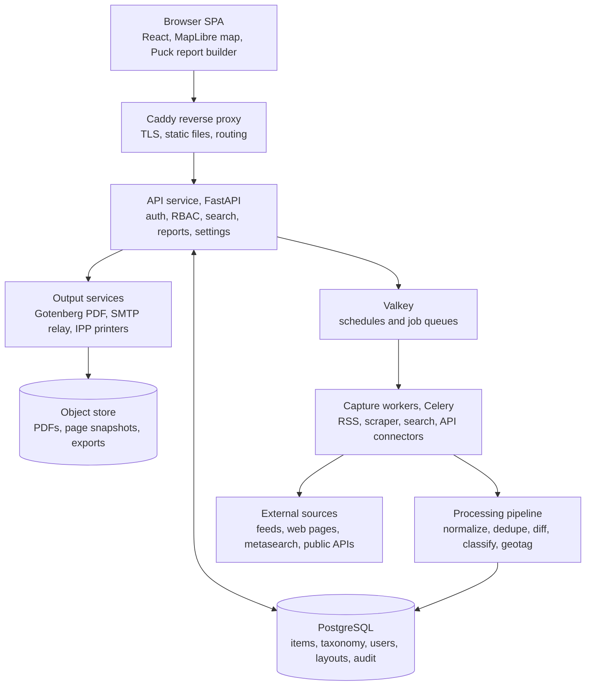

# 3. Architecture and technology stack

Decision: a modular monolith API (Python, FastAPI) with a separate worker pool for capture and processing, PostgreSQL as the only system of record, a React single-page application with a MapLibre choropleth, and sidecar containers for PDF rendering and optional search. Every component is permissively licensed or runs as an unmodified service behind a network boundary. Rationale and alternatives are recorded in ADR-0001 to ADR-0008 (section 3.7).

## 3.1 Component view

Reading: the browser talks only to the API through the proxy. Workers do all outbound fetching, so the API never reaches the internet; this is the SSRF boundary enforced in section 8. The processing pipeline is the only writer of captured items.

## 3.2 Stack decisions

| Layer | Choice | License | Why this and not the alternative |
| --- | --- | --- | --- |
| API | Python 3.12, FastAPI, Pydantic v2, SQLAlchemy 2, Alembic | MIT (all) | Same language as the scraping ecosystem (Scrapy, trafilatura, feedparser); auto-generated OpenAPI drives contract tests. Alternative Node/NestJS rejected to avoid two backend languages. |
| Workers and scheduling | Celery with Celery Beat, broker Valkey | BSD-3 (Celery), BSD-3 (Valkey) | Mature retry, rate-limit and periodic-task features. Valkey replaces Redis because Redis moved to RSAL/SSPL/AGPL licensing in 2024, which fails the license policy for bundled components. Alternative Procrastinate (PostgreSQL queue, MIT) noted for smaller deployments. |
| Database | PostgreSQL 16 with JSONB, full-text search, pg_trgm, optional pgvector | PostgreSQL License | One store for relational data, dynamic attributes (JSONB) and search avoids an extra search cluster for 50 users. Meilisearch (MIT) is the scale-out path if search latency exceeds 300 ms at p95. Elasticsearch rejected (SSPL/ELv2/AGPL). |
| Frontend | React 18, TypeScript, Vite, TanStack Query/Table/Router, Tailwind CSS, shadcn/ui on Radix primitives | MIT (all) | Largest ecosystem of accessible primitives; shadcn/ui components are copied into the repo so they can be themed for light, dark and high-contrast. |
| Map | MapLibre GL JS rendering a Natural Earth GeoJSON fill layer; optional self-hosted vector basemap via PMTiles | BSD-3 (MapLibre), public domain (Natural Earth), BSD-3 (PMTiles) | No tile subscription needed for a choropleth; vector rendering keeps country boundaries crisp in dark mode. Leaflet (BSD-2) is the fallback if WebGL is unavailable. |
| Charts | Apache ECharts | Apache-2.0 | Accessible labels, built-in dark theme, timeline and bar charts for reports. |
| Report builder | Puck visual editor with custom field components; dnd-kit for list ordering | MIT (both) | Puck already provides drag-and-drop page composition, saved JSON layouts and a plugin API, which covers REQ-12 and REQ-13. react-grid-layout (MIT) is the fallback if Puck's layout model proves too page-centric. |
| PDF rendering | Gotenberg container (Chromium and LibreOffice behind an HTTP API) | MIT | Renders the same HTML the browser prints, so screen and PDF match. WeasyPrint (BSD) is the fallback without a browser engine. |
| Email | aiosmtplib plus Python stdlib email; Mailpit in development | MIT (both) | Any SMTP relay; no vendor SDK. |
| Printing | Browser print dialog always; server-side IPP printing behind a feature flag, deferred from the first release (R-04, BL-13, BL-15) | n/a | pycups is GPL-2 and excluded; no Node IPP client passed the license gate. Python clients (ippx, aioipp; MIT) printed to a test server, but need a contract change (BL-15). |
| Authentication | Local accounts with Argon2id hashing (argon2-cffi), server-side sessions, optional OpenID Connect via Authlib in Phase 5; Keycloak as the reference identity provider for testing | MIT, BSD-3, Apache-2.0 | Keeps Phase 1 small; SSO added without changing the permission model. |
| Authorization | Role and permission tables in PostgreSQL enforced by a FastAPI dependency; Casbin considered if policies grow beyond role-to-permission | Apache-2.0 (pycasbin) | Explicit tables are auditable and simple for the admin UI in M1. |
| Content extraction | html5lib parsing with the project's own CSS-subset selectors and main-text heuristic (ADR-0009, CP-15), the project's own bounded crawl (ADR-0009 amendment 2), Playwright for JavaScript-rendered pages | MIT, BSD-3, Apache-2.0 | trafilatura, readability-lxml and Scrapy were dropped: what they install bundles LGPL code (libiconv in lxml's wheels, chardet) and CNRI-Python (regex). |
| Feed parsing | feedparser | BSD-2 | De facto standard; handles malformed feeds. |
| Change detection | Own implementation using the approach of changedetection.io (Apache-2.0): fetch, extract, normalize, hash, diff with difflib | Apache-2.0 | Borrow patterns and optionally vendored helpers with attribution; do not run the whole app, since its UI duplicates ours. |
| Internet search | Provider interface with two implementations: self-hosted SearXNG instance (separate container, unmodified) and a commercial search API configured by key | AGPL-3.0 (service boundary only), n/a | SearXNG is used over HTTP and never modified or vendored; see license policy 3.5. |
| Optional classification | Rules engine first (keyword and taxonomy matching); optional language-model classifier behind one interface supporting a local model server or a hosted API, feature-flagged | MIT (Ollama) | No captured text leaves the deployment unless an admin enables a hosted provider (G6). |
| Reverse proxy and TLS | Caddy | Apache-2.0 | Automatic certificates, simple config. |
| Observability | structlog, OpenTelemetry SDK, Prometheus metrics endpoint; Grafana optional as tooling | MIT, Apache-2.0, Apache-2.0, AGPL (tooling only) | Grafana is never bundled with the product image. |
| Packaging | Docker Compose with health checks; multi-stage images; Kubernetes manifests deferred | Apache-2.0 (Compose spec) | Matches default G1. |

## 3.3 Runtime topology (default deployment)

Containers: `proxy` (Caddy), `api`, `worker` (scaled 1 to N), `beat` (scheduler, exactly one), `db` (PostgreSQL), `queue` (Valkey), `pdf` (Gotenberg), `search` (SearXNG, optional), `print-bridge` (optional), `mailpit` (development only). Persistent volumes: `pgdata`, `objectstore`. All inter-container traffic on an internal network; only `proxy` publishes ports 80 and 443.

## 3.4 Cross-cutting conventions

- **API style:** REST with JSON, versioned under `/api/v1`, OpenAPI 3.1 generated by FastAPI and committed as `openapi/regwatch.v1.json`; breaking changes require a new version path and an ADR.
- **Identifiers:** UUIDv7 primary keys everywhere (time-ordered, safe to expose).
- **Time:** stored in UTC, rendered in the user's time zone preference.
- **Dynamic attributes:** each captured item carries a validated JSONB `attributes` object whose schema is defined by taxonomy facets in M2, indexed with GIN.
- **Events:** internal domain events (`item.captured`, `item.changed`, `report.rendered`, `output.sent`) published on the queue; consumers include the map cache invalidator and the notification digest.
- **Configuration:** twelve-factor environment variables validated at startup by a Pydantic settings model; runtime-editable settings live in the `settings` table and are cached with invalidation on write.
- **Feature flags:** a `feature_flags` table read by API and workers; every optional integration (hosted model, server printing, SSO, metasearch) is behind a flag.
- **Error handling:** RFC 9457 problem-details responses; worker failures recorded in `capture_runs` with the exception class and a truncated message, never raw page content.

## 3.5 License policy (summary; full text in section 8.6)

Allowed for bundled code and assets: MIT, BSD-2, BSD-3, ISC, Apache-2.0, PostgreSQL, Zlib, Unlicense, CC0, public domain, PSF-2.0 (Python runtime and libraries such as typing-extensions; owner decision BL-53), SIL OFL-1.1 for fonts only, with the license file shipped beside the font files (owner decision BL-57), MIT-0, BlueOak-1.0.0 and Python-2.0 (permissive; owner decision BL-59), Unicode-3.0 (permissive notice license; owner decision BL-78, ADR-0003 amendment 3), MPL-2.0 (file-level; modified MPL files must be published), CC-BY-4.0 for data with attribution. Review required (ADR per use): LGPL-2.1/3.0 (dynamic linking only), EPL-2.0. Prohibited in bundled code: GPL-2.0/3.0, AGPL-3.0, SSPL, BUSL/BSL, Elastic License, RSAL, Commons Clause, Sustainable Use License, CC-BY-NC, CC-BY-SA for code. Permitted as unmodified separate services or developer tooling, never vendored: AGPL and GPL applications (SearXNG, Grafana, k6, Semgrep CLI). Every exception needs an ADR approved by the owner.

## 3.6 Component register

Verification status: **V** means an agent opened the LICENSE file in the project repository at a tagged release, or, for a repository that has no tags, at default-branch HEAD on the date recorded (marked "untagged"); the short commit SHA(s) at which it was read follow the V (full SHAs, tags and file paths in `docs/research/R-01-license-verification.md`); **S** means confirmed through package indexes or project pages and must be re-verified against the LICENSE file by the Phase 0 research agent before use. Reuse mode: dependency, service (runs unmodified behind HTTP), vendored (code copied with attribution), pattern (approach borrowed, code rewritten), tooling (development or test only).

| Component | Role | License | Status | Reuse mode | Module |
| --- | --- | --- | --- | --- | --- |
| FastAPI | API framework | MIT | V `7a0a3f0` | dependency | M0 |
| Uvicorn | ASGI server for `regwatch-api` (#27) | BSD-3 | V `3eb9a9a` | dependency | M0 |
| Pydantic | validation, settings | MIT | V `aa540ac` | dependency | M0 |
| pydantic-settings | `Settings` from environment variables (#27) | MIT | V `94150a0` | dependency | M0 |
| SQLAlchemy, Alembic | ORM, migrations | MIT | V `2f6968c`, `47da01c` | dependency | M0 |
| PostgreSQL 16 | database | PostgreSQL | V `7d3e000` | service | M0 |
| asyncpg 0.32.0 | PostgreSQL driver for SQLAlchemy and Alembic (#28; psycopg is LGPL-3.0, CP-01 #39) | Apache-2.0 | V `d701e11` | dependency | M0 |
| greenlet 3.5.6 | SQLAlchemy asyncio bridge (#28) | MIT; Stackless-derived files PSF-2.0 | V `abfe740` | dependency | M0 |
| Mako 1.4.3, MarkupSafe 3.0.4 | Alembic revision templates (#28) | MIT, BSD-3 | V `6b833ae`, `ece2607` | dependency | M0 |
| PyYAML 6.0.3 | seed and taxonomy YAML (#28) | MIT | V `49790e7` | dependency | M0, M2 |
| NIST OSCAL content: CSF 2.0 catalog | `control_framework` seed terms, withdrawn entries filtered (#28, R-03 C5, BL-21) | CC0-1.0 and US public domain | V `f0de6d8` (LICENSE.md) | data (generated seed) | M2 |
| UN M49 standard country or area codes | `jurisdiction.region_code` seed (#28) | © United Nations; codes used as identifiers only; terms page not reachable from the session (assumed, ASSUMPTIONS.md) | page read 2026-11-02 | data (generated seed) | M2 |
| pgvector | vector index (optional) | PostgreSQL | V `f37c13f` | dependency | M5 |
| Celery 5.7.0 | task queue and Beat scheduler (ADR-0006) | BSD-3; its rendered docs are CC BY-SA 4.0, not in the wheel | V `3f4d8d7`, `6fcdbf9` (v5.7.0), R-01 C4 | dependency | M3 |
| kombu 5.7.0, amqp 5.4.2, billiard 4.3.2, vine 5.1.0 | Celery's messaging, AMQP client (installed, unused with the Valkey broker), worker pool and promises | BSD-3 | V `703e96f`, `9d4a51a`, `895817a`, `8c08b39`, R-01 C5 to C8 | dependency | M3 |
| click-didyoumean 0.3.1, click-plugins 1.1.1.2, click-repl 0.4.1, prompt-toolkit 3.0.53, wcwidth 0.9.4 | Celery's command line | MIT, BSD-3, MIT, BSD-3, MIT (wcwidth's Unicode tables carry a no-conditions notice) | V `e571cc8`, `4ac07e5`, `4cc38ff`, `583b341`, `2a8edf1`, R-01 C9 to C13 | dependency | M3 |
| python-dateutil 2.9.0.post0, six 1.17.0, tzlocal 5.4.5 | Celery's schedule and time-zone handling | Apache-2.0 AND BSD-3, MIT, MIT | V `1ae8077`, `ebd9b3a`, `ab833e7`, R-01 C14 to C16 | dependency | M3 |
| Valkey | broker and cache | BSD-3 | V `29173b6` | service | M3 |
| feedparser 6.0.14 | RSS and Atom parsing (the RSS connector) | BSD-2 | V `14425f6` (v6.0.14), R-01 C17 | dependency | M3 |
| feedparser-sgmllib 2.1.0 | feedparser's tolerant HTML and SGML tokenizer | Python-2.0 | V `36924f1` (v2.1.0), R-01 C18 | dependency | M3 |
| Scrapy | crawling framework: not used (ADR-0009 amendment 2; it installs lxml, whose wheels bundle LGPL-2.1 libiconv, and fetches through its own Twisted client, outside SafeFetcher) | BSD-3 | V `8026dee` | not used | M3 |
| trafilatura 1.8+ | main-text extraction: not used (ADR-0009; lxml's wheels bundle LGPL-2.1 libiconv, and regex is CNRI-Python) | Apache-2.0 (GPLv3 before 1.8.0) | V `e2f85c9` | not used | M3 |
| readability-lxml | fallback extraction: not used (ADR-0009; needs LGPL chardet) | Apache-2.0 | V `7159b09` | not used | M3 |
| html5lib 1.1 | HTML parsing for extraction, as browsers parse (ADR-0009) | MIT | V `f87487a` (1.1), R-01 C19 | dependency | M3 |
| webencodings 0.5.1 | html5lib's character-encoding labels | BSD-3 | V `fa2cb5d` (v0.5.1), R-01 C20 | dependency | M3 |
| Jinja2 3.1.6 | server-side report HTML with autoescape (M7 spec; ADR-0005 decision 3 deferred, BL-17) | BSD-3 | V: `LICENSE.txt` in the 3.1.6 wheel (Copyright 2007 Pallets, BSD 3-clause text), 2026-11-20 | dependency | M7 |
| MarkupSafe 3.0.4 | Jinja2's escaping (already present through another dependency) | BSD-3 | V: `License-Expression: BSD-3-Clause` and `LICENSE.txt` in the 3.0.4 wheel, 2026-11-20 | dependency | M7 |
| Playwright (Python) | JavaScript page rendering, E2E tests | Apache-2.0 | V `bcb9deb` | dependency, tooling | M3, tests |
| changedetection.io | change-detection approach | Apache-2.0 | V `16974bf` | pattern | M3, M4 |
| SearXNG | metasearch, discovery only (ADR-0010); image `searxng/searxng@sha256:0b9f3ddd…` (tag `2026.11.17-b99cf7496`) | AGPL-3.0 | V `9ded3be` (untagged HEAD, 2026-11-01) | service (unmodified) | M3 |
| httpx | HTTP client with timeouts | BSD-3 | V `26d48e0` | dependency | M3 |
| protego 0.7.0 | robots.txt parser for SafeFetcher (M3 design notes; acceptance 4) | BSD-3-Clause | V `06ccad4` (0.7.0) | dependency | M3 |
| tenacity 9.2.1 | bounded retries for capture fetches (at most 3 per run, M3 design notes) | Apache-2.0 | V `4410996` (9.2.1) | dependency | M3 |
| redis-py 8.1.0 | Valkey client: SafeFetcher's per-host rate limits, and the broker client Celery's Redis transport uses | MIT | V `e013126` (v8.1.0) | dependency | M3 |
| lingua-language-detector 2.2.0 | language detection (M4 Q6; owner approved 2026-11-18; `processing/language.py`). The wheel is about 290 MB (models included, offline); its CycloneDX SBOM lists 131 Rust crates, all Apache-2.0, MIT, Unlicense-or-MIT or Unicode-3.0 | Apache-2.0 | V `d0c8e85`, `754ce21`; wheel 2.2.0 LICENSE and SBOM checked | dependency | M4 |
| spaCy (optional) | entity extraction | MIT | V `4331199` | dependency | M4 |
| rapidfuzz 3.14.6 | fuzzy title near-duplicates (M4 Q6; owner approved 2026-11-18; `processing/neardup.py`); wheel about 12 MB | MIT | V `377d0c0`; wheel 3.14.6 License-Expression MIT checked | dependency | M4 |
| pypdf 7.1.1 | PDF text for body-only items (M4 roadmap 4.5; owner decision 2026-11-19; `processing/pdf.py`, run in the sandboxed `processing.pdf_child` with CPU and memory limits); pure Python, no runtime dependencies (the crypto extras are not installed), about 2 MB | BSD-3-Clause | wheel 7.1.1 License-Expression and LICENSE checked | dependency | M4 |
| OpenSearch 3.9.0 (image `opensearchproject/opensearch@sha256:3bf4fe26…e076`) | search, facets and map aggregations beside PostgreSQL (ADR-0011, CP-22); internal network only, security plugin on with the stack's CA and a least-privilege user | Apache-2.0 (bundled OpenJDK GPL-2.0 with Classpath Exception, inside the unmodified service) | V core tag 3.9.0 `4ee42a9`; security plugin and opensearch-build LICENSE checked 2026-11-19 | service (unmodified) | M5 |
| React, React DOM | UI | MIT | V `61aa00d` | dependency | M6 |
| Vite | build | MIT | V `981f07f` | tooling | M6 |
| TypeScript, pnpm, Prettier | compiler, package manager, formatter (#27) | Apache-2.0, MIT, MIT | V `c63de15`, `d22a3f6`, `1172b82` | tooling | M0 |
| typescript-eslint, eslint-plugin-react-hooks, eslint-plugin-jsx-a11y | lint rules (#27) | MIT | V `4ad6b75`, `d1727fb`, `7f3d698` | tooling | M0 |
| DefinitelyTyped (`@types/react`, `@types/react-dom`, `@types/node`) | type declarations (#27) | MIT | V `8239b0b` (untagged HEAD, 2026-11-02) | tooling | M0 |
| Node.js 22 (`node:22-slim` image) | runtime of the web development server only; not shipped (#27) | MIT, with bundled third-party notices | V `27f2131`, `14b1d12` (untagged HEAD, 2026-11-02) | tooling (base image) | M0 |
| TanStack Query, Table, Router | data and routing; Query 5.107.1 and Router 1.170.46 ship from M1 and M2 (sign-in, admin screens) | MIT | V `a6be1ce`, `95c4768`, `6b9fe6d` | dependency | M1, M2, M6 |
| TanStack runtime packages: @tanstack/query-core, router-core, history, store, react-store; seroval, seroval-plugins, cookie-es, isbot, use-sync-external-store | transitive runtime dependencies of TanStack Query and Router (web review finding 6) | MIT; isbot Unlicense | S, licence from each installed package.json (2026-11-15); repository LICENSE files to read at release (BL-52) | dependency (transitive) | M1, M2, M6 |
| Tailwind CSS | styling | MIT | V `c2b24dd` | dependency | M6 |
| shadcn/ui, Radix UI | accessible components | MIT | V `96da9cc`, `9aebdd4` | vendored (by design) | M6 |
| MapLibre GL JS 6.19.0 (exact pin; its worker emitted as a same-origin file) | map rendering, in the `identity` projection over boundaries pre-projected to Equal Earth (ADR-0004 amendment 1); lazy-loaded on the map route | BSD-3 | V `538a768` | dependency | M6 |
| MapLibre runtime packages (inlined in MapLibre's prebuilt `dist` at the versions it was built with; the installed copies are what the scan checks, zustand is declared but unused in `dist`): @mapbox/jsonlint-lines-primitives, @maplibre/vt-pbf, bidi-js, gl-matrix, json-stringify-pretty-compact, minimist, murmurhash-js, protocol-buffers-schema, require-from-string, zustand (MIT); @mapbox/point-geometry, @maplibre/geojson-vt, @maplibre/maplibre-gl-style-spec, earcut, kdbush, potpack, quickselect, tinyqueue (ISC); @mapbox/tiny-sdf, @mapbox/unitbezier (BSD-2-Clause); @mapbox/vector-tile, pbf (BSD-3-Clause); @maplibre/mlt (MIT OR Apache-2.0) | dependencies of MapLibre 6.19.0, inventoried by `pnpm licenses list --prod` and `scripts/license-scan.sh` (2026-11-19) | MIT, ISC, BSD-2-Clause, BSD-3-Clause, MIT OR Apache-2.0 | scan: all allowed | dependency (transitive) | M6 |
| lucide-react 1.76.0 | toolbar and rail icons (screens.md component conventions; owner approved 2026-11-19 on recommendation); no runtime dependencies; notices in `web/THIRD_PARTY_NOTICES.md` | ISC AND MIT (Feather-derived icons) | V `de8d11a` (tag 1.76.0) | dependency | M6 |
| Inter variable font 4.1 (latin and latin-ext woff2, taken from @fontsource-variable/inter 5.3.0) | the design brief's typeface, self-hosted in `web/src/styles/fonts/` with its license (no font CDN; sha256 in `web/THIRD_PARTY_NOTICES.md`); owner approved 2026-11-19 on recommendation | OFL-1.1 (allowed for fonts, 3.5) | V `e3a3d4c` (rsms/inter v4.1); fontsource `5a72889` (untagged HEAD, 2026-11-19) | vendored font files | M6 |
| Natural Earth 1:50m admin-0 | country boundaries and disputed-areas overlay (v5.1.2, built to GeoJSON by script; R-05, ADR-0004) | Public domain | V `f1890d9` | vendored data | M6 |
| world-atlas / topojson-client | simplified topology | ISC | V `a912c0a`, `71e5bd6` | reject: GeoJSON built from Natural Earth instead (R-05, BL-12) | M6 |
| mapshaper | build-time boundary simplification and conversion | MPL-2.0 | V `b44c0fa` | tooling | M6 |
| i18n-iso-countries | ISO 3166 names | MIT | V `55c3a72` | dependency | M2 |
| Apache ECharts | charts | Apache-2.0 | V `c5a48f5` | dependency | M6, M7 |
| Puck (@puckeditor/core 0.24.0, exact pin; formerly @measured/puck) | drag-and-drop layout editor; `Render` for server HTML (R-02, ADR-0005 proposed) | MIT | V `d14401c` | dependency | M7 |
| dnd-kit | drag-and-drop primitives | MIT | V `3910e27` | dependency | M7 |
| Gotenberg | HTML to PDF | MIT | V `3d4f655` | service | M8 |
| WeasyPrint | fallback PDF | BSD-3 | V `4d3b7b6` | dependency | M8 |
| aiosmtplib | SMTP client | MIT | V `9cc4254` | dependency | M8 |
| Mailpit | development mail catcher | MIT | V `364916b` | tooling | M8 |
| ipp (npm) | IPP printing bridge | none (MIT claimed; no LICENSE file) | rejected (R-01 E1, R-04) | not used; print bridge deferred (BL-13) | M8 |
| argon2-cffi | password hashing | MIT | V `1fcae4f` | dependency | M1 |
| google-re2 1.1.20251105 (RE2 with statically linked Abseil and pybind11) | linear-time regular expressions for term match rules, run on captured text (BL-74, M2 review finding 1) | BSD-3-Clause; bundled Abseil Apache-2.0, pybind11 BSD-3-Clause | V `927f5d5` (tag 2025-11-05, which `python/setup.py` builds as 1.1.20251105); bundled libraries identified from the extension's symbols | dependency | M2, M4 |
| nh3 0.3.7 (Python binding to the Rust ammonia sanitizer; the wheel statically links ammonia 4.1.4, html5ever 0.39, cssparser 0.37, url 2.5 with ICU4X 2.3 and PyO3 0.29, 85 crates in its `Cargo.lock`) | allowlist HTML sanitizer: the rendered `/legal` page (BL-68), and captured HTML at ingestion later (8.1) | MIT; bundled crates MIT or Apache-2.0, cssparser and dtoa-short MPL-2.0 (unmodified), 18 ICU4X crates Unicode-3.0 (allowed by BL-78, ADR-0003 amendment 3; notice in `api/THIRD_PARTY_NOTICES.md`) | V `74f36b8` (nh3 v0.3.7), `fba7512` (ammonia v4.1.4); crate licenses from crates.io for every `Cargo.lock` entry | dependency | M1 |
| markdown-it-py 4.3.0, mdurl 0.1.2 | CommonMark renderer for `legal.page_markdown`, raw HTML off (`MarkdownIt("js-default")`), output passed through nh3 (BL-68) | MIT, MIT | V `d504583` (v4.3.0), `596bf1c` (mdurl 0.1.2) | dependency | M1 |
| defusedxml 0.7.1 | parses an uploaded SVG logo with DTDs, entities and external references refused, before an allowlist check that rejects scripts (BL-68, M1 acceptance 6) | PSF-2.0 | V `ebff1b4` (v0.7.1) | dependency | M1 |
| python-multipart 0.0.33 | `multipart/form-data` parser that Starlette's `Request.form()` needs, for the logo upload (one file part, 2 MB body cap; BL-68) | Apache-2.0 | V `9217f26` (0.0.33) | dependency | M1 |
| Authlib | OpenID Connect client | BSD-3 | V `46b9487` | dependency | M1 |
| Keycloak | reference identity provider for tests | Apache-2.0 | V `24ed1da` | tooling, optional service | M1 |
| pycasbin (optional) | policy engine | Apache-2.0 | V `f858158` | dependency | M1 |
| Caddy | reverse proxy | Apache-2.0 | V `72dd0fb` | service | M10 |
| structlog, OpenTelemetry, prometheus-client | observability | MIT OR Apache-2.0, Apache-2.0, Apache-2.0 | V `8174a86`, `ad75594`, `9b6b971` | dependency | M10 |
| Grafana, Prometheus | dashboards (ops only) | AGPL-3.0, Apache-2.0 | V `752e346`, `bae3ece` | tooling | M10 |
| pytest, pytest-cov, Hypothesis | Python tests | MIT, MIT, MPL-2.0 | V `ae1d0ff`, `66c8a52`, `255a880` | tooling | tests |
| pytest-asyncio | async tests (#27) | Apache-2.0 | V `e420349` | tooling | tests |
| Schemathesis | property-based contract tests of the API against its OpenAPI document (#30) | MIT | V `5fac3a5` (v4.33.0) | tooling | tests |
| PyYAML, types-PyYAML (typeshed) | loading the contract YAML in the OpenAPI semantic diff (#30) | MIT, Apache-2.0 | V `49790e7` (6.0.3), `956ce07` (typeshed untagged HEAD, 2026-11-02) | tooling | tests |
| openapi-typescript, openapi-fetch, openapi-typescript-helpers | web API types generated from the contract, typed fetch client (#30) | MIT | V `5709d33` (tags openapi-typescript@7.13.0, openapi-fetch@0.17.0; one monorepo) | tooling, dependency | M0 |
| uv, Ruff, mypy | Python environments, lint and format, type check (#27) | MIT OR Apache-2.0, MIT, MIT (mypyc runtime files PSF-2.0) | V `3010295`, `ba65abf`, `ad02a35` | tooling | M0 |
| CPython 3.12 (`python:3.12-slim` image) | runtime in the api image (#27) | PSF-2.0 (image packaging MIT) | V `f6650f9`, `f4c67ec` (untagged HEAD, 2026-11-02) | runtime (base image) | M0 |
| Vitest, Testing Library | frontend tests | MIT | V `7a825db`, `20ce75f`, `6049cc0` | tooling | tests |
| jest-dom, user-event (Testing Library), jsdom | DOM matchers, user interaction and DOM for Vitest (#27) | MIT | V `3782c78`, `1951eb7`, `058c0f5` | tooling | tests |
| axe-core, @axe-core/playwright 4.14.0 (exact pin) | accessibility tests | MPL-2.0 | V `e797173`, `2375f7f` | tooling | tests |
| @playwright/test 1.65.1 (exact pin) and the official image `mcr.microsoft.com/playwright@sha256:1507cbfc…5579` (v1.65.1-noble) | end-to-end tests (`make e2e`, `scripts/e2e.sh`; M6 acceptance 3 and 4); browsers come from the image, none are downloaded into the repository | Apache-2.0 | V `bbd9483` (tag v1.65.1) | tooling | tests |
| k6 | load tests | AGPL-3.0 | V `e088784` | tooling | tests |
| OWASP ZAP | dynamic security scan | Apache-2.0 | V `8a1bff3` | tooling | security |
| Semgrep CLI, Bandit, ESLint | static analysis | LGPL-2.1, Apache-2.0, MIT | V `4fe07d8`, `92ae8b8`, `12cbff4` | tooling | security |
| Trivy, gitleaks, pip-audit | image, secret and dependency scanning | Apache-2.0, MIT, Apache-2.0 | V `e713f67`, `83d9cd6`, `8894eb8` | tooling | security |
| GitHub Actions `actions/checkout`, `actions/setup-node`, `actions/cache`, `astral-sh/setup-uv` | CI steps in `ci.yml`, pinned by commit SHA (#29) | MIT | V `3d3c42e`, `949feb2`, `55cc834`, `68559e9` | tooling (CI) | M0 |
| ScanCode toolkit or license-checker and pip-licenses | license inventory | Apache-2.0 AND CC-BY-4.0, BSD-3, MIT | V `abd87fb`, `05f5e14`, `a870ce4` | tooling | compliance |
| Ollama (optional) | local model server | MIT | V `04088e7` | service | M4 |
| EUR-Lex / Cellar SPARQL and content API | EU legal data source | Commission Decision 2011/833/EU (data) | terms read 2026-11-01 (R-06) | service (external API) | M3 |
| Federal Register API | US federal regulatory data source | US government work (data) | terms partly read 2026-11-01 (R-06, BL-27) | service (external API) | M3 |
| legislation.gov.uk API and feeds | UK legislation data source | OGL v3.0 (data) | terms read 2026-11-01 (R-06) | service (external API) | M3 |
| LibreTranslate 1.9.6 (official image) | default local translation provider | AGPL-3.0 | V `497f6c6` | service (unmodified) | M4 |
| Argos Translate (library) | in-process translation | MIT; 1.11+ requires minisbd (AGPL-3.0, V `ecd8225`); 1.10.0 downloads a CC BY-SA spaCy model at import | V `63b84ec` (1.11.0), `561369a` (1.10.0) | rejected for launch (R-08 F1, F2; BL-40) | M4 |
| Argos/OPUS-MT models zh, fr, es, pt → en 1.9 | translation models (data) | CC-BY-4.0 with attribution (package README) | S (no LICENSE file in package) | data, fetched by LibreTranslate | M4 |
| Argos models de → en 1.3, ja → en 1.1 | translation models (data) | none stated | unverified (R-08 F3; BL-42) | data, fetched by LibreTranslate; owner decision | M4 |
| Hosted translation API (Azure Translator EU or Google Translation v3 EU; DeepL paid tiers) | optional `http` provider | commercial terms | n/a (R-08 documentation review) | external service by key | M4 |

Status note: research item R-01 (#3, 2026-11-01) verified 50 of 51 rows against their LICENSE files. `ipp` (npm), whose repository has no LICENSE file (R-01 E1), was rejected by R-04 (#6, `docs/research/R-04-ipp-client.md`): the first release ships browser printing only, and no IPP client is registered until BL-15 is decided. R-01 also corrected the register text for the Puck package name, the structlog dual license and the ScanCode data license.

## 3.7 Architecture decision records to write in Phase 0

All eight are `proposed`; the owner accepts them at Gate G0 (#2). Index: `docs/decisions/README.md`.

| ADR | Decision | Alternatives considered | Status |
| --- | --- | --- | --- |
| [ADR-0001](decisions/ADR-0001-modular-monolith.md) | Modular monolith API plus worker pool | Microservices per connector; serverless functions | accepted (G0) |
| [ADR-0002](decisions/ADR-0002-postgresql-search.md) | PostgreSQL as system of record and first search engine | Meilisearch, OpenSearch, Elasticsearch | accepted (G0) |
| [ADR-0003](decisions/ADR-0003-license-policy.md) | License policy and the service-boundary exception for AGPL tooling | Strict permissive-only; no exceptions | accepted (G0) |
| [ADR-0004](decisions/ADR-0004-map-boundaries.md) | MapLibre with vendored Natural Earth GeoJSON | Leaflet with raster tiles; D3 geo projections; ECharts geo | accepted (G0) |
| [ADR-0005](decisions/ADR-0005-report-builder.md) | Puck for the report builder | Custom dnd-kit grid; GrapesJS (BSD-3) | accepted (G0); decision 3 deferred (BL-17) |
| [ADR-0006](decisions/ADR-0006-celery-valkey-scheduling.md) | Celery and Valkey for scheduling | Procrastinate; APScheduler in-process; Temporal | accepted (G0); amendment 1 accepted 2026-11-17 (run lock in PostgreSQL) |
| [ADR-0007](decisions/ADR-0007-local-auth-then-oidc.md) | Local authentication first, OpenID Connect later | Keycloak from day one | accepted (G0) |
| [ADR-0008](decisions/ADR-0008-gotenberg-pdf.md) | Gotenberg for PDF | WeasyPrint only; browser-side pdfmake | accepted (G0) |
| [ADR-0010](decisions/ADR-0010-internet-search-provider.md) | SearXNG for discovery only, no fallback key yet | Exa or Brave free-tier fallback; a paid API; no search at launch | accepted 2026-11-18 |
| [ADR-0009](decisions/ADR-0009-own-html-extraction.md) | Own HTML extraction on html5lib | trafilatura with lxml from source; trafilatura with an LGPL exception; `html.parser` | accepted 2026-11-17 |

## 3.8 Phase 0 open-source review protocol (REQ-19, REQ-20)

1. For each module, the research agent searches GitHub topics and package indexes for candidates (minimum five per capability) and records them in `docs/research/Mx-candidates.md` using the component evaluation template.
2. Scoring (1 to 5 each): license fit, activity in the last 12 months, test coverage and CI presence, documentation, open security advisories, API fit, bundle or image size.
3. Decision per candidate: dependency, service, vendored, pattern, or reject, with one sentence of reasoning.
4. A vendored component gets a `THIRD_PARTY_NOTICES.md` entry with copyright line, license text and the source commit; vendored files keep their original header.
5. The register in 3.6 is updated and the module's questioning issue references the research file.
