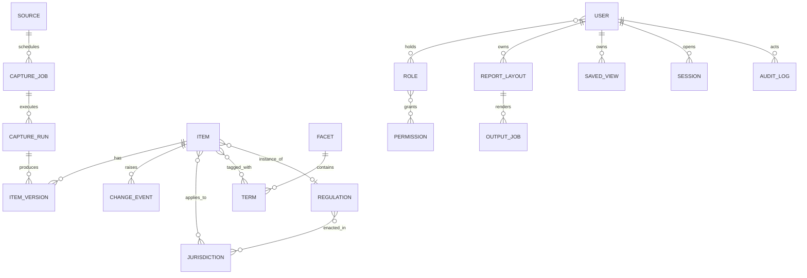

# 4. Domain and data model

Decision: a fixed relational core (users, sources, items, jurisdictions, reports, audit) plus a dynamic taxonomy layer where administrators define facets and terms at runtime. Items carry a JSONB `attributes` document validated against the active facet definitions, so new taxonomy dimensions never require a migration (REQ-03, REQ-11).

## 4.1 Entity overview

## 4.2 Core entities

| Entity | Purpose | Key fields (beyond `id`, `created_at`, `updated_at`) |
| --- | --- | --- |
| `jurisdiction` | Country, subdivision or supranational body shown on the map | `code` (ISO 3166-1 alpha-2, ISO 3166-2, or custom such as `EU`), `name`, `kind` (country, subdivision, supranational), `parent_id`, `region_code` (UN M49 region), `geometry_ref` (feature id in the vendored GeoJSON), `active` |
| `source` | A configured origin of data | `name`, `kind` (rss, web_page, web_crawl, search_query, api_feed, manual), `url`, `config` JSONB (connector-specific), `default_jurisdiction_ids`, `default_term_ids`, `credibility` (official, secondary, news), `robots_policy` (respect, override with `override_reason`), `enabled`, `owner_user_id` |
| `capture_job` | Schedule and settings for one source | `source_id`, `cron` or `interval_seconds`, `timezone`, `max_items_per_run`, `rate_limit_per_minute`, `render_js` boolean, `extraction_rules` JSONB (CSS or XPath selectors, include and exclude patterns), `change_threshold_pct`, `enabled`, `next_run_at` |
| `capture_run` | One execution of a job | `job_id`, `started_at`, `finished_at`, `status` (success, partial, failed, skipped), `items_new`, `items_changed`, `items_unchanged`, `error_class`, `error_message` (truncated), `http_status`, `bytes_fetched` |
| `item` | A canonical captured document (law, bill, guidance, press release, article) | `source_id`, `canonical_url`, `url_hash`, `title`, `summary`, `language`, `published_at`, `discovered_at`, `last_changed_at`, `content_hash`, `status` (new, updated, unchanged, archived), `attributes` JSONB (validated by facets), `search_vector` tsvector (generated), `embedding` vector (optional) |
| `item_version` | Immutable snapshot of extracted content | `item_id`, `run_id`, `version_no`, `content_text`, `content_html_ref` (object store key), `content_hash`, `diff_from_previous` (unified diff, truncated to 64 KB), `changed_pct` |
| `change_event` | Something that should light up the map or a digest | `item_id`, `jurisdiction_id`, `kind` (new_item, content_changed, status_changed, effective_date_reached), `occurred_at`, `severity` (info, notable, major), `summary`, `acknowledged_by`, `acknowledged_at` |
| `regulation` | Optional curated record grouping items about one instrument | `title`, `short_name`, `instrument_type` (act, regulation, directive, bill, guidance, standard, decision), `status` (proposed, adopted, in_force, amended, repealed), `adopted_at`, `in_force_at`, `official_url`, `attributes` JSONB |
| `facet` | A taxonomy dimension | `key` (topic, industry, technology, regulation_type, custom), `label`, `value_type` (term, text, number, date, boolean), `multi` boolean, `required` boolean, `show_in_view_selector` boolean, `show_in_filters` boolean, `sort_order`, `system` boolean (cannot be deleted) |
| `term` | A controlled vocabulary value | `facet_id`, `key`, `label`, `parent_id` (hierarchy), `synonyms` text[], `match_rules` JSONB (keywords, regex, language), `color_token`, `active` |
| `item_term` | Tagging join | `item_id`, `term_id`, `confidence` (0 to 1), `assigned_by` (rule, model, user), `assigned_user_id` |
| `item_jurisdiction` | Jurisdiction join | `item_id`, `jurisdiction_id`, `confidence`, `assigned_by` |
| `user` | Account | `email` (unique, case-insensitive), `display_name`, `password_hash` (Argon2id) nullable for SSO users, `external_subject` nullable, `status` (active, disabled, locked), `must_change_password`, `last_login_at`, `failed_logins`, `preferences` JSONB (theme, contrast, font_scale, density, locale, timezone, landing_view, session_timeout_minutes) |
| `role` | Named bundle of permissions | `key`, `label`, `system` boolean |
| `permission` | Function right | `key` (for example `items.read`, `sources.manage`, `reports.build`, `reports.print`, `outputs.email`, `settings.manage`, `users.manage`, `audit.read`), `description` |
| `role_permission`, `user_role` | Joins | |
| `session` | Server-side session | `user_id`, `token_hash`, `created_at`, `expires_at`, `last_seen_at`, `ip`, `user_agent`, `revoked_at` |
| `saved_view` | A stored map or table configuration | `user_id` (null for shared), `name`, `view_by` (country, region, regulation, industry, technology), `filters` JSONB, `period_days`, `color_scheme`, `is_default`, `shared` |
| `report_template` | Stock report definition shipped with the app | `key`, `label`, `description`, `layout` JSONB (Puck data), `query` JSONB, `version` |
| `report_layout` | A user-built layout from the report builder | `user_id`, `name`, `based_on_template_key` nullable, `layout` JSONB (Puck data), `query` JSONB, `page_size`, `orientation`, `shared`, `version` |
| `output_job` | A render or delivery request | `requested_by`, `kind` (pdf, email, print, csv), `report_layout_id` or `saved_view_id` or `query` JSONB, `destination` JSONB (emails, printer id), `status` (queued, rendering, sent, failed), `artifact_ref`, `error_message`, `scheduled_cron` nullable |
| `printer` | Admin-registered network printer | `name`, `ipp_url`, `default_media`, `enabled` |
| `setting` | Runtime configuration | `key`, `value` JSONB, `scope` (global), `updated_by` |
| `feature_flag` | On and off switches | `key`, `enabled`, `description` |
| `audit_log` | Who did what | `actor_user_id`, `action`, `entity_type`, `entity_id`, `before` JSONB, `after` JSONB, `ip`, `occurred_at` (append-only; no update or delete grants) |

## 4.3 Dynamic attributes contract

- `facet.key` becomes a property name in `item.attributes`. The API validates writes against the active facets: unknown keys are rejected unless the facet `custom` allows free-form keys; `required` facets must be present when a user saves an item manually; captured items may be incomplete and are flagged `needs_review`.
- Term-typed facets store term keys (strings) in `attributes` for fast JSONB filtering and mirror them into `item_term` for joins, confidence and provenance. A nightly consistency job reconciles the two.
- Indexes: GIN on `item.attributes` (jsonb_path_ops), GIN on `item.search_vector`, B-tree on `item.last_changed_at`, `item.published_at`, composite on `item_jurisdiction(jurisdiction_id, item_id)`, unique on `item.url_hash`.
- The view selector (REQ-11) reads facets where `show_in_view_selector` is true, so administrators add a new dimension (for example "enforcement body") by creating a facet, not by changing code.

## 4.4 Map aggregation query

The map needs, per jurisdiction, the count and most recent `change_event.occurred_at` within the user's period and filters. Implement as a SQL view `jurisdiction_activity(period_start, filters)` backed by a materialized rollup refreshed on `item.changed` events (debounced to once per 30 seconds) and a fallback to live aggregation when the rollup is older than 5 minutes. Target: under 150 ms at p95 for 250 jurisdictions and 1 million items.

## 4.5 Seed data

- Jurisdictions: all ISO 3166-1 countries from `i18n-iso-countries`, plus `EU`, `COE`, `OECD`, `UN`, `INTL`. Region codes from UN M49.
- Facets and terms: `topic` (cybersecurity, data protection, privacy, critical infrastructure, incident reporting, AI governance, digital identity, telecoms security, product security, cloud and outsourcing, cross-border transfer, encryption, consumer protection), `industry` (finance, health, energy, telecoms, public sector, defence, transport, retail, technology, all), `technology` (cloud, AI and machine learning, IoT, cryptography, identity, networks, software supply chain, mobile, operational technology), `regulation_type` (act, regulation, directive, bill, guidance, standard, decision, enforcement action, consultation).
- Roles: `admin` (all permissions), `editor` (items, sources, reports, outputs), `analyst` (items read, reports build and print, outputs own), `viewer` (items read, stock reports print).
- Starter sources (official feeds, verified in Phase 2): EUR-Lex RSS by subject, Federal Register API (public domain), legislation.gov.uk feeds, NIST CSRC publications RSS, CISA advisories RSS, ENISA news RSS, UK ICO news RSS, Australian OAIC news, Singapore CSA news, Japan NISC, Brazil ANPD, Canada OPC. Each starter source records its terms of use in `config.terms_url`.

## 4.6 Migration rules for agents

1. One Alembic revision per PR; never edit a merged revision.
2. Every table has `id UUID PRIMARY KEY DEFAULT uuidv7()` (function shipped in revision 0001), `created_at`, `updated_at` with trigger.
3. Destructive changes (drop column or table) require a two-step expand and contract across releases and an ADR.
4. Migrations must be reversible or carry a documented reason they are not.
5. Seed data lives in `seed/` as YAML loaded by an idempotent command, not inside migrations.
