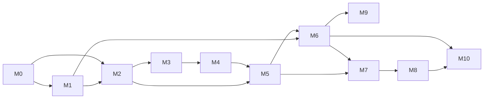

# 5. Module index

Eleven modules cover the 27 requirements. Each module has a full specification in `docs/modules/`. Sizes: S under 3 agent-days, M 3 to 6, L 6 to 12, XL above 12.

| Module | File | Phase | Size | Requirements | Parallel with |
| --- | --- | --- | --- | --- | --- |
| M0 Platform scaffold and developer experience | `modules/M0-platform-scaffold.md` | P1 | M | REQ-01, 19, 20, 26, 27 | nothing (first) |
| M1 Identity, access control, administration | `modules/M1-identity-access-admin.md` | P1 | L | REQ-14, 16, 07 | M2 |
| M2 Taxonomy and dynamic data model | `modules/M2-taxonomy-dynamic-data.md` | P1 | M | REQ-03, 11 | M1 |
| M3 Capture framework and connectors | `modules/M3-capture-framework.md` | P2 | XL | REQ-02, 04, 05 | M5; connectors in parallel after core |
| M4 Processing and enrichment | `modules/M4-processing-enrichment.md` | P2 | L | REQ-02, 03, 06 | M5; after M3 core |
| M5 Search and query API | `modules/M5-search-query.md` | P2 | M | REQ-03, 09, 11, 15 | M3, M4 |
| M6 Application shell and world map UI | `modules/M6-shell-map-ui.md` | P3 | XL | REQ-06, 07, 08, 09, 11, 17, 18 | M9; three sessions after shell |
| M7 Report builder and stock reports | `modules/M7-report-builder.md` | P4 | L | REQ-10, 12, 13 | M8 |
| M8 Output and delivery | `modules/M8-output-delivery.md` | P4 | M | REQ-10, 15 | M7 |
| M9 User tab, preferences, session controls | `modules/M9-user-preferences.md` | P3 | S | REQ-14, 18 | M6 |
| M10 Operations, observability, hardening | `modules/M10-operations-hardening.md` | P5 | M | REQ-25, 01 | M1b (SSO) |

## Spec structure (every module file follows it)

Purpose · Scope (in, out) · Interfaces · Data · Open-source components with licenses · Design notes · Acceptance criteria · Test plan · Question bank · Enhancements to propose.

## Dependency graph

